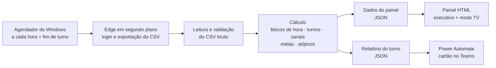

# WMS Produtividade — pipeline automático de produtividade de separação

Automação que, de hora em hora, entra no WMS, extrai o relatório de produtividade, calcula os indicadores por usuário, turno e canal, publica um painel executivo e, ao fim de cada turno, envia o resultado para diretoria, gerência e coordenação no Microsoft Teams. Roda sozinha, sem ninguém abrir o sistema.

`Go` · `chromedp (automação de navegador)` · `JavaScript` · `HTML/CSS` · `Chart.js` · `Power Automate / Teams` · `Agendador de Tarefas do Windows`

> **Estudo de caso.** Sistema desenvolvido para a operação da empresa onde atuo. Este repositório documenta o problema, a arquitetura e os resultados. O código-fonte fica em repositório privado e pode ser demonstrado em entrevista. Marca e dados da empresa foram omitidos.

## Problema

A liderança do centro de distribuição só conhecia a produtividade da separação depois que alguém extraía um relatório do WMS e montava uma planilha. O número chegava tarde demais para corrigir o turno em andamento e dependia de trabalho manual repetido várias vezes ao dia.

## Solução



- **Extração sem API.** O WMS não oferece API para esse relatório. O programa controla o Microsoft Edge em segundo plano (Chrome DevTools Protocol, via `chromedp`), faz login, abre a transação, consulta o dia e exporta o CSV, usando um perfil temporário que é apagado ao terminar.
- **Transformação.** O CSV bruto vira indicadores: peças, tarefas, pedidos e endereços por bloco de hora; turno por usuário (sem contar a mesma peça em dois turnos); canal pelo número do pedido; peças/hora contra a meta de cada canal; tarefas e pedidos atípicos (janela maior que 2 h).
- **Painel.** HTML, CSS e JavaScript puros, embutidos no executável (`go:embed`). Tem filtros por dia, turno e canal, histórico de 31 dias, exportação em CSV e um **modo TV** para o chão de operação.
- **Decisão no fim do turno.** O relatório do turno é gravado em JSON e enviado como cartão ao Teams por um fluxo do Power Automate, com destinatários e texto editáveis no próprio painel.

## Decisões de engenharia

- **Credenciais fora do código e fora de arquivos:** usuário, senha e URL do fluxo ficam em variáveis de ambiente do usuário do Windows.
- **Falha segura no login:** se o WMS recusa a senha, as execuções são suspensas para não bloquear o usuário, e o painel mostra o motivo.
- **Envio com garantia de entrega:** relatório não enviado é reenviado nas execuções seguintes por até 24 h; se a rede bloquear a saída direta, o envio passa pelo navegador.
- **Gravação segura em pasta sincronizada:** os arquivos são montados fora da pasta e trocados de uma vez, para o painel nunca ler um arquivo pela metade.
- **Reprocessamento determinístico:** `WMSProdutividade processar "Exportacao.csv" "pasta"` recalcula o painel a partir de um CSV, sem acessar o WMS.
- **Executável único**, sem instalação e sem dependências na máquina de destino.

## Estrutura do código

```
main.go                    menu, execução agendada e comando "processar"
wms.go · navegador.go      acesso ao WMS pelo Edge
dados.go                   leitura do CSV exportado
calculo.go · turnos.go     regras de dia, blocos de hora, turnos, canais e metas
atipicos.go                tarefas e pedidos com janela acima do limite
html_painel.go · web/      dados e arquivos do painel (inclui tv.html)
teams*.go                  envio ao fluxo do Power Automate
credenciais.go             variáveis de ambiente
agenda.go · sistema_*.go   Agendador de Tarefas do Windows
excel.go · painel.go       planilha Excel opcional
*_test.go                  testes
docs/                      manual de operação e instruções de compilação
```

Cerca de 7.200 linhas de Go e 2.200 de front-end.

## Testes

Testes automatizados em Go (`go test ./...`) cobrem as regras de atípicos, credenciais e gravação segura; os de integração com Teams e navegador rodam quando as variáveis de ambiente estão definidas.

## O que este projeto demonstra

- **Pipeline de dados automatizado e agendado**, da extração à entrega, com monitoramento de falha.
- **Transformação de dado bruto em decisão operacional**, com regras de negócio explícitas e testadas.
- **Integração entre sistemas sem API** e entrega em canais que a liderança já usa.
- **Software de produção em Go:** binário único, tratamento de erro, testes e documentação.
- **Ponto de partida para IA aplicada:** a série histórica por usuário, turno e canal é a base para detecção de anomalias e previsão de produtividade.

## Próximos passos

- Detecção automática de anomalias de produtividade por turno.
- Resumo do turno em linguagem natural gerado por LLM a partir do relatório JSON.
- Painel de exemplo com dados sintéticos para demonstração.

## Autor

Victor Nathan Batista Ribeiro — estudante de Tecnologia em Agentes Inteligentes (FIAP).
